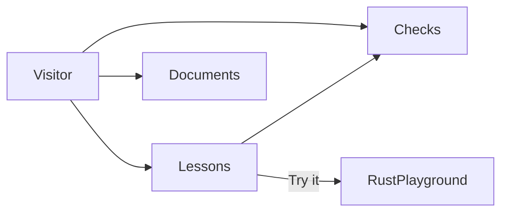
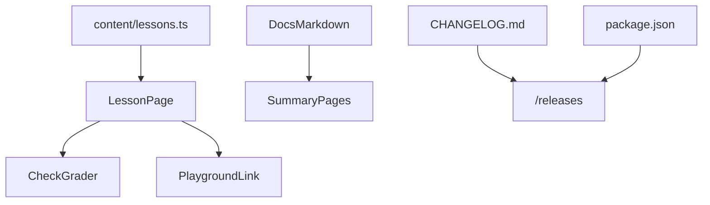
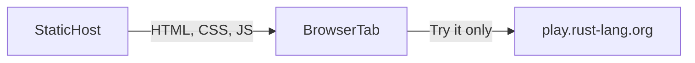

# Architecture and design

**Product:** Ferrugo

**Last updated:** 2026-10-15

## Summary

Ferrugo is a static Next.js site. Lessons live in `content/lessons.ts`. The browser compares a chosen answer with the lesson's answer and shows the explanation. Try it builds a link to the official Rust playground and does not compile anything here.

`/vision` and `/architecture` read the Summary section of the two documents at build time. `/releases` renders `CHANGELOG.md`. The header chip reads the version from `package.json`.

Hosting is a free static export. There is no database and no paid API. The pictures on the architecture page are the conceptual, logical, and physical views. The Mermaid diagrams later in this document are the same three views, and they change together.

## Conceptual

The visitor meets lessons, checks, and the living documents. A lesson can hand a program to the Rust playground. The playground is outside this product. Checks are not.

Lessons are the thirteen programs, ordered from `fn main` through `Result`. Checks are questions about those programs. Documents are the vision, the architecture, and the release notes. The playground compiles a program only after the visitor chooses Try it.

## Logical

Lesson text, the documents, and the version are separate inputs. The lesson page is the only one that grades a check or builds a playground link.

- `content/lessons.ts` holds the chapter, the explanation, the program, the notice, and the checks. The answer id stays with the check. The page compares the chosen option with that id.
- `src/lib/docs.ts` reads a file at build time and returns the body of `## Summary`. The vision and architecture pages render that body. They do not keep a second copy.
- `src/lib/playground.ts` builds `https://play.rust-lang.org/` with `version=stable`, `mode=debug`, `edition=2024`, and the lesson program.
- `package.json` version is the header chip. `CHANGELOG.md` is the releases page.
- The three pictures on `/architecture` are SVG in `src/components/architecture/Diagrams.tsx`. They match these Mermaid diagrams.

## Physical

The host stores files. The browser grades checks. Compilation happens on the Rust project's playground, and only after Try it.

- The static host is Vercel Hobby, serving the Next.js export in `out/`. The export contains the pages, the fonts, the bridge photograph, and the icon. It does not contain a compiler.
- The browser downloads those files and grades checks in the tab. Answers are not sent to Ferrugo and are not stored.
- `play.rust-lang.org` receives the snippet when the visitor opens Try it. That request is the visitor's, to the Rust project, not to a Ferrugo API.

## Visual system

The chrome matches AetherForge.

- Tokens in `src/app/globals.css`: ink `#152028`, muted `#5A6B76`, accent `#0F4C5C` / hover `#0C3D4A`, line `#D8C4AA`, paper `#F6EAD8`.
- Type: Source Serif 4, Source Sans 3, IBM Plex Mono, shipped as files under `src/app/fonts/` so a production build does not download them.
- Body: fixed `hero-bg.jpg`, a rusted iron truss bridge. A light-brown wash (`#F6EAD8`) is stronger over the content column and lighter at the edges.
- Chrome: sticky header and footer use that light brown with a blur. Surfaces use `.panel`. Buttons are `.btn-accent` and `.btn-ghost`.
- The mark is a bridge arch on a warm tan circle (`#E6CA98`), in the header and in `public/icon.svg`.
- The product name in the header is Ferrugo, with no subtitle.

## Decisions

| Decision | Choice | Why |
| --- | --- | --- |
| Site | Next.js static export | Zero cost, no server to keep |
| Checks | Graded in the browser | No account and no round trip |
| Compiler | Official playground | A Rust compiler does not ship as a small file in the page |
| Edition | Rust 2024, stable | The programs match current Rust |
| Docs in the app | Summary section only | The page stays short. The file stays complete |
| Pictures | SVG on the page, Mermaid in this document | Both describe the same three views |
| Name | Ferrugo | The product name is that word alone |
| Visual system | AetherForge tokens and type | One family with the other rooms |
| Backdrop | Rusted iron bridge | The span the lessons cross |

## Changelog

- 2026-10-15 — First room: static export, lessons, in-browser checks, playground links, three architecture views, and summary pages.
